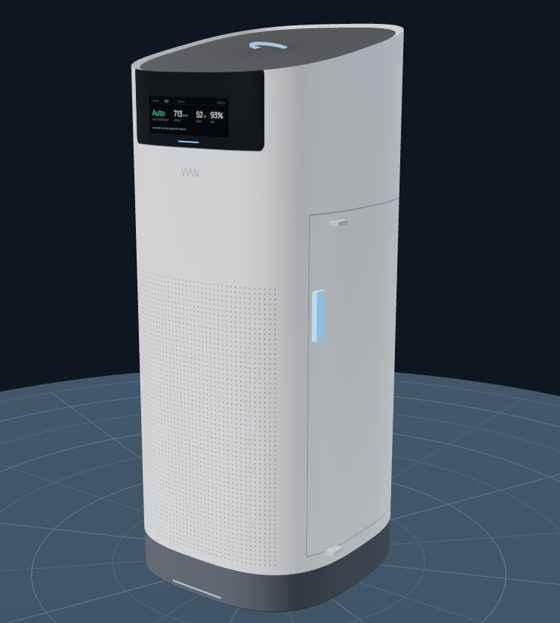
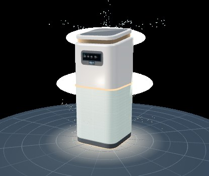
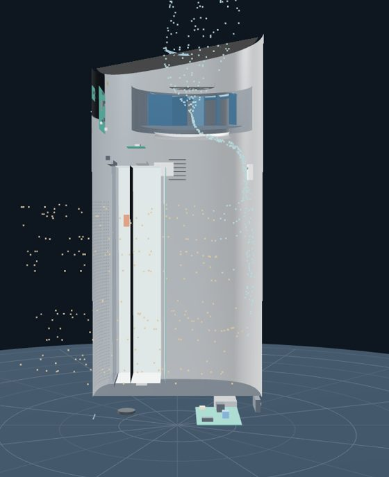

# VIAN Air Purifiers — interactive 3D product models

Concept design and engineering study for a family of VIAN air purifiers, presented as an interactive website
with real-time 3D models that run in the browser.

**Live site:** https://adrianaantony75-oss.github.io/vian-hospital-03/



| | |
|---|---|
|  |  |
| VIAN Slope Glow final design | Cut-away showing the airflow path |

## What's inside

| Page | Description |
|---|---|
| [`index.html`](index.html) | Product pitch: the two purifiers, competitor research, filter technologies, feature comparison, engineering checks and the cost model |
| [`hospital.html`](hospital.html) | **VIAN Hospital 03** — interactive 3D engineering model: explode the parts, inspect each component, view the airflow and the 3-stage filter |
| [`home.html`](home.html) | **VIAN Home** — 3D model of the home unit with its display, connectivity and filter layout |
| [`studio.html`](studio.html) | Design studio: concept shapes compared side by side, with 2D wind-tunnel (CFD) results |
| [`final/index.html`](final/index.html) | VIAN Home 700 manufacturing pack: specifications, stability, fan and noise design, filter life, electronics, wiring, moulds and pricing |
| [`final/model.html`](final/model.html) | Editor for the final model: move, resize and recolour parts, adjust the lights and pop-up top, and export the changes as text |

## Features
- Real-time 3D models built with three.js: orbit, zoom, exploded views, part selection and per-part details
- Animated airflow and an illuminated logo / light-ring preview
- Works on desktop and mobile (layout stacks on phones)
- Engineering deliverables for the final design:
  - 3D-printable STL parts and scale models (`stl/`, `final/stl/`)
  - DXF drawings for panels, cut-outs and the filter (`final/drawings/`, `final/filter/`)
  - Bill of materials, netlists and board outlines for six circuit boards (`final/electronics/`)
  - Mechanical data: parts list, fasteners, mass budget, stability, fan operating points, noise targets
  - ESP32-S3 firmware for fan control, lift motor, lighting, display, touch keys and safety cut-offs
    (`final/firmware/`, see its [README](final/firmware/README.md))
  - A complete manufacturing pack as PDF and ZIP

## Tech stack
- HTML, CSS and vanilla JavaScript — no build step
- [three.js](https://threejs.org) 0.147 (loaded from jsDelivr) for WebGL rendering
- Arduino / ESP32-S3 (C++) for the firmware
- Hosted on GitHub Pages

## Run locally
The site is static. Open it through any local web server, for example:

```bash
python -m http.server 8000
```
Then visit `http://localhost:8000/`. An internet connection is needed for three.js.

## Status
This is a concept and portfolio project. The designs, calculations and manufacturing files are engineering
studies; the product has not been manufactured, lab-tested or certified, and prices are estimates.

## Author
Designed by Adrian A. Antony.
